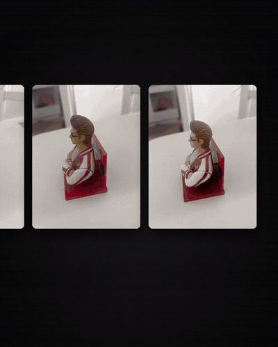

# Photo to 3D

Drop phone photos on the left, get a colored 3D model on the right — ready for Blender or Unity (`.glb`).



Full video: [docs/demo.mp4](docs/demo.mp4)

## What it does

1. **Photos in** — 4–10 phone photos of an object, from all sides
2. **Background removed locally** — [rembg](https://github.com/danielgatis/rembg) with BiRefNet, on your own PC
3. **3D generation** — [TRELLIS](https://github.com/microsoft/TRELLIS) (open source, Microsoft) through the free Hugging Face Space `trellis-community/TRELLIS`
4. **Model out** — rotate it in the browser, download `.glb`

No GPU is needed on your PC. Building one model takes about a minute.

## Finding: more photos ≠ better everywhere

Same figure, 5 photos vs 9 photos:

| | 5 photos | 9 photos |
|---|---|---|
| Face, glasses, hair | flat, glasses wrong | much closer to the real figure |
| Back of the stand | invented (white + logo) | red, like the real one |
| Crossed arms | red stripes kept | stripes mostly lost |

The 4 extra photos were mostly close-ups from one side; only one photo showed the front.
TRELLIS's default multi-image mode (`stochastic`) conditions each step on one photo, so the
likely cause is that the front got under-represented. The `multidiffusion` mode (all photos every
step) is the next thing to test. **Angles matter more than count.**

## Honest limits

- Small text (like the name on the base) stays blurry
- Sides you don't photograph are guessed by the AI
- Thin parts and glasses need close-up photos
- The demo video is real output: the turntables are rendered from the actual `.glb` files,
  and the app scene is captured from the running app (the ~1 minute build is shortened)

## Run it

```bash
pip install -r requirements.txt
echo HF_TOKEN=hf_your_read_token > .env      # free account at huggingface.co/settings/tokens
uvicorn app:app --port 8770
# open http://localhost:8770
```

The free Hugging Face GPU quota allows a few builds per day.

## Files

| Path | What |
|---|---|
| `app.py`, `web/index.html` | the web app (FastAPI + model-viewer) |
| `pipeline.py` | background removal + TRELLIS call |
| `scripts/cutout.py`, `scripts/trellis.py` | the same steps from the command line |
| `scripts/turntable.js`, `scripts/capture_app.js`, `scripts/compose.py` | how the demo video is made (headless Chrome + Pillow + ffmpeg) |
| `models/plant_trellis/model.glb` | sample model: potted plant from 4 photos |

The figure model is not included — it is a licensed character, shown in the video only.
